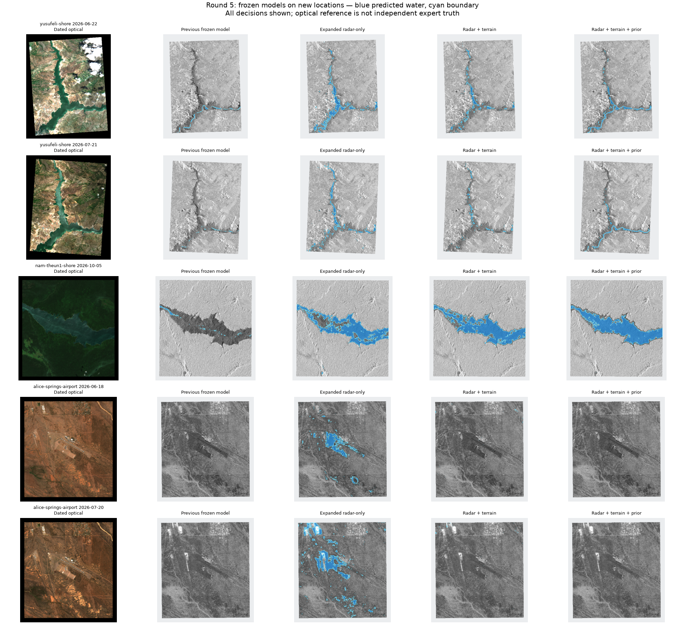

# NISAR Water

Headless open-water segmentation and water-body evolution from scientific NISAR
radar data. Input is GCOV HH/HV power; output is a blue water fill, cyan boundary,
scientific rasters, polygons and comparable-support time-series metrics. The
team's application can consume these artifacts through the included FastAPI
result service. No frontend is required.

**Research status: `not_ready_for_general_use`.** The software runs end to end;
the models still miss difficult reservoir water. Reported scores use automated
optical weak references, not independent expert shoreline truth.

## Try it with your own Earthdata token

[Open in Colab](https://colab.research.google.com/github/Ch0comilo/NISAR-Models/blob/main/nisar-water/notebooks/NISAR_Water_Try_Your_Data.ipynb)
or open [the public notebook](notebooks/NISAR_Water_Try_Your_Data.ipynb) locally.
It accepts your own Bearer token through a hidden prompt, acquires bounded real
NISAR crops without sibling projects, displays water/borders and temporal
support, and checks the saved-result HTTP API. It does not save credentials.
Draw a rectangle on the interactive map to set the actual acquisition AOI.
Each date compares the unclassified HH radar image and the model overlay side
by side, with identical display bounds and gray scale.
See [the Spanish notebook guide](docs/notebook-earthdata.md).

```sh
uv sync --frozen --extra notebook
uv run --no-sync jupyter lab notebooks/NISAR_Water_Try_Your_Data.ipynb
```

## Start in this folder

This directory is the repository root. On the original development computer:

```powershell
cd 'C:\Users\danie\Documents\NISAC 2\nisar-water'
```

Work here, rather than in the older agent/UI projects. After cloning elsewhere,
run commands from the cloned `nisar-water` directory; no Windows-specific paths
or sibling project are needed for local HDF5/NetCDF inference.

## Install and run an offline software check

Python **3.13** is the tested runtime; the package supports Python 3.12–3.13.
Use [uv](https://docs.astral.sh/uv/) and the checked-in lockfile:

```sh
uv sync --frozen --extra test --python 3.13
uv run --no-sync python scripts/check_repository.py
uv run --no-sync python -m pytest -q --basetemp=.pytest-work
uv run --no-sync python scripts/smoke_test.py --output outputs/smoke-01
```

The smoke check uses clearly marked **synthetic pixels**, the shipped radar
checkpoint, two-date inference, real exports and in-process HTTP requests. It
needs no Earthdata token, satellite download, GPU, Torch or sibling repository.
It verifies software operation; it measures no real-world accuracy. Use a fresh
output directory for each run.

The [delivery verification](docs/repository-validation.md) records a real Git
clone/install, 79 passing applicable tests and actual cached NISAR inference
with raster/vector/HTTP checks. Optional Docker and remote CI execution are
listed separately from the completed checks.

## Model used

The current model is scikit-learn **HistGradientBoostingClassifier**, trained
on actual NISAR observations. Three small frozen checkpoints are included
(about 1.6 MiB total), with hashes in [checkpoints/manifest.json](checkpoints/manifest.json).

| Model directory | Features | Threshold | Intended role |
|---|---:|---:|---|
| `checkpoints/round5/radar` | 41 radar | 0.20 | Validation-selected diagnostic |
| `checkpoints/round5/terrain` | 41 radar + 5 terrain | 0.10 | Terrain comparison |
| `checkpoints/round5/terrain_prior` | 41 radar + 5 terrain + 3 prior/availability | 0.10 | Conservative comparison |

The examples below explicitly use the conservative comparison profile. **No
candidate passed every validation target.** This profile was frozen before the
test and was not promoted to an accepted model after seeing favorable results.
Missing required terrain is unknown, not nonwater. Historical water is a learned
soft feature and can still bias predictions against new water.

The model uses 300 boosting iterations, at most 31 leaves, learning rate 0.05,
minimum leaf size 40 and L2 regularization 10. All three round5 fits use the
same 203,678 sampled training cells. Read the [architecture](docs/architecture.md)
and [portable model card](checkpoints/README.md) for feature and training details.
Only load trusted joblib checkpoints.

## Test another NISAR observation

Use **NISAR L-band GCOV, frequency A, HHHH/HVHV linear gamma0 power**, with a
native north-up UTM grid at 10 or 20 m. Processing uses 20 m pixels. A PNG/JPEG
radar screenshot, dB array, amplitude, VV/VH product or frequency B is not an
interchangeable input.

1. Obtain a scientific GCOV `.h5` through your normal NASA Earthdata/ASF workflow.
2. Copy [examples/aoi.geojson](examples/aoi.geojson) and set its WGS84 polygon
   to your study area. The example location must overlap your input granule.
3. Run a bounded crop. Keep the original product filename, which identifies
   acquisition time and geometry.

```sh
uv run --frozen nisar-water hdf5 /path/to/NISAR_L2_PR_GCOV_....h5 --aoi examples/aoi.geojson --model checkpoints/round5/terrain_prior --context-cache .cache/terrain-context --output outputs/my-river-01
```

Replace the input path with the real filename. Quote paths containing spaces.
`--context-cache` explicitly enables bounded public DEM/HAND/JRC fetching; it
is separate from obtaining the radar HDF5. Without it, context lookup uses
existing cached sources only and may withhold unsupported pixels. For a purely
radar diagnostic, use `--model checkpoints/round5/radar` and omit the context
option.

Pass a directory of compatible GCOV HDF5 files to process every supplied
observation. Different tracks, passes and frames become separate series:

```sh
uv run --frozen nisar-water hdf5 /path/to/gcov-directory --aoi examples/aoi.geojson --model checkpoints/round5/terrain_prior --context-cache .cache/terrain-context --output outputs/my-river-time-series-01
```

To reuse the original notebook's `pila` input:

```python
from nisar_water.pipeline import predict_dataset

result = predict_dataset(
    pila,
    model_dir="checkpoints/round5/terrain_prior",
    output_dir="outputs/notebook-river-01",
    context_cache_dir=".cache/terrain-context",
    series_id="my-river",
)
```

For NetCDF, retain the scientific variables, acquisition names/times, coordinates
and units, then run:

```sh
uv run --frozen nisar-water netcdf /path/to/water-input.nc --model checkpoints/round5/terrain_prior --context-cache .cache/terrain-context --output outputs/netcdf-river-01
```

[Testing new observations](docs/testing-new-data.md) covers the complete input
contract, Python worker, catalog input, temporal comparison and error diagnosis.
The `aoi` command now has a standalone bounded CMR/Earthdata reader. The public
notebook supplies the user's token in memory; automated callers can set
`EARTHDATA_TOKEN` in the worker environment. No full-granule fallback exists.
`--reference-root` explicitly selects the older research adapter when needed;
it is not required by the new default reader.

## API integration

The implemented API serves **saved results**. Run inference with the CLI/Python
worker, then start the result service:

```sh
uv run --frozen nisar-water serve --root outputs/my-river-01 --port 8010 --assessment benchmarks/round5/assessment.json --origin http://localhost:5173
```

| Endpoint | Response |
|---|---|
| `GET /health` | Service availability |
| `GET /water/assessment` | Current scientific readiness and failures |
| `GET /water/series` | Computed series and manifest URLs |
| `GET /water/series/{key}` | Observations, map assets and temporal metrics |
| `GET /assets/...` | PNG, GeoTIFF, GeoJSON and provenance assets |
| `GET /docs` | Interactive implemented API documentation |

`GET /water/benchmark` is available when the result root contains `report.json`.
`/health` does not certify model accuracy. Always display the assessment with the
results; the historical evaluation label inside frozen metadata is not an
acceptance decision.

**HTTP inference submission is a future integration step.** The API currently
has no `POST` upload/job route. The worker and output schema are ready to wrap
in an asynchronous job service; see [API integration](docs/api-integration.md),
[OpenAPI](docs/openapi.json) and the [frontend contract](docs/frontend-contract.md).
Use `--host 0.0.0.0` only when you intend to expose the server beyond localhost.

A container recipe is supplied in [Dockerfile](Dockerfile). It serves a mounted
result directory and the packaged assessment. See the API guide for commands;
container execution is optional and has not been validated on this workstation.

## Output files

| File | Meaning |
|---|---|
| `sar.png`, `composite.png` | Radar view, and radar with highlighted water |
| `water.png`, `border.png` | Transparent blue fill and cyan boundary |
| `uncertain.png` | Unsupported/excluded observed area |
| `water-mask.tif` | COG: 0 nonwater, 1 water, 254 unknown, 255 unobserved |
| `water-score.tif` | Uncalibrated model score, NaN where unclassified |
| `water.geojson` | WGS84 water polygons |
| `context-provenance.json` | Physical inputs and source hashes, for physical profiles |
| `series.json`, `timeline.csv` | Per-observation metadata, areas and comparable support |
| `change-*.tif`, `water-occurrence.tif` | Common-support extent changes and observed occurrence |

Web overlays have EPSG:4326 display bounds; scientific rasters retain their UTM
transform. Plot `waterOnCommonAllDatesHa` with `commonAllDatesHa` when showing
evolution. Unknown or missing radar coverage must not become zero water.

## Measured results and remaining failures

Round5 used 71 training scenes, six validation scenes and **five fresh test
images at three held-out regions**. On the same scored weak-reference support:

| Frozen profile | Water precision | Water recall | Land false-positive rate |
|---|---:|---:|---:|
| Radar | 27.18% | 74.14% | 3.17% |
| Radar + terrain | 96.02% | 72.17% | 0.0478% |
| Radar + terrain + prior | 99.95% | 75.49% | 0.000577% |

The prior profile recalls 92.28% at Nam Theun 1 and predicts no false water on
14,086.80 ha of Alice Springs reference land, but recalls only 19.73% at Yusufeli.
These selected, correlated regional observations do not establish worldwide
accuracy. There are no expert-reviewed shoreline labels in the current fits.



[Full experiment results](docs/improved-classifier-results.md) preserve the
limitations, test discipline and historical comparison. [Research history](docs/research-history.md)
records the earlier workspace experiments; its data-dependent commands are not
the fresh-clone quick start.

## Repository layout

```text
checkpoints/             Three portable frozen HGB profiles and integrity manifest
benchmarks/round5/       Authoritative current scientific assessment
src/nisar_water/         Adapters, features, model, exports, time series and API
examples/               AOI and a minimal Python inference worker
scripts/                Repository checks, smoke test and historical research tools
tests/                  Offline software tests
notebooks/README.md     Location of local executed research notebooks
docs/                   Architecture, new-data testing, API and experiment results
.github/workflows/      Windows/Linux software checks
```

Raw satellite data, private credentials, caches, original model experiments,
generated outputs, executed research notebooks and the vendored comparator
runtime stay local and are excluded by `.gitignore`. Current portable checkpoint
files are intentionally versioned separately under `checkpoints/`.

No code/checkpoint license has been selected on the owner's behalf. See
[LICENSE](LICENSE) and [third-party notices](THIRD_PARTY_NOTICES.md). Choose the
team's intended license before offering open-source reuse. The shared GitHub
repository is [Ch0comilo/NISAR-Models](https://github.com/Ch0comilo/NISAR-Models);
this package is its `nisar-water/` subdirectory.

See [the GitHub handoff](docs/repository-handoff.md) for cloning, repository
layout and archive guidance.
