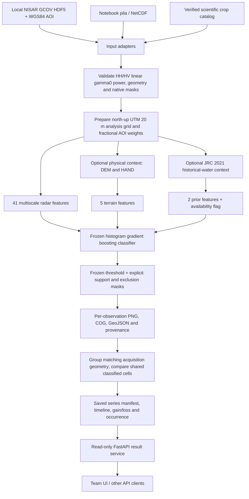

# Architecture

NISAR Water is a headless scientific inference worker with a read-only FastAPI
service for its saved results. It maps open water in each supplied acquisition,
then compares observations on shared classified support. It does not infer the
cause of water change. All current checkpoints remain experimental and
`not_ready_for_general_use`.

## Data flow

The context branches are present only for the selected model profile. Optical
imagery supplies development reference labels and review context; it is not an
inference input. A current radar acquisition does not require a cloud-free
optical image or a later radar acquisition.

## Models used

The distributed profiles are exact copies of frozen round5 checkpoints. Each
directory contains `model.json` and `estimator.joblib`.

| Profile | Portable model directory | Features | Frozen threshold | Role |
|---|---|---:|---:|---|
| Radar | `checkpoints/round5/radar` | 41 | 0.20 | Validation-selected diagnostic candidate |
| Radar + terrain | `checkpoints/round5/terrain` | 46 | 0.10 | Frozen comparison candidate |
| Radar + terrain + prior | `checkpoints/round5/terrain_prior` | 49 | 0.10 | Conservative frozen comparison candidate |

The classifier is scikit-learn `HistGradientBoostingClassifier`: 300 boosting
iterations, at most 31 leaves, learning rate 0.05, minimum 40 samples per leaf,
L2 regularization 10, no early stopping and random seed 20261028. The round5 fits
used the same 203,678 retained training cells across all three profiles: 95,393
water and 108,285 nonwater. Geographic regions receive equal total confidence
weight. Validation chooses operating points before test predictions are opened.
No round5 family passed every validation target, so validation selection is not
production acceptance.

The HGB family provides a compact CPU model and allows direct comparison of
radar, terrain and historical context. It learns more than a single darkness
threshold, but dark land and difficult reservoir water remain failure modes.
The conservative profile substantially suppresses false water and still misses
much Yusufeli reservoir water. Historical-water features can introduce bias
against new water even though they are soft learned inputs. See
[results and limitations](improved-classifier-results.md).

Radar features include HH/HV dB values, channel contrast, gradients and local
power/texture/support statistics in 3, 7, 15 and 31 cell windows, corresponding
to 60, 140, 300 and 620 m at the analysis posting. Power averaging happens before
the logarithm. Feature tiles include a halo so their boundaries do not create
artificial seams.

The five physical features are DEM slope, local relief, log1p HAND, mean HAND and
minimum HAND. Optional historical context adds JRC 2021 water occurrence,
distance to historically frequent water capped at 1,000 m, and a prior
availability flag. There is no absolute-coordinate or absolute-elevation model
feature. COP DEM/HAND/JRC sources have nominal 30 m resolution; interpolating
them onto a 20 m grid does not create finer independent terrain measurements.
JRC is not a hard water mask and does not forbid a new reservoir or flood.

The loader verifies checkpoint hashes and feature versions. Use only trusted
model files: joblib is an executable Python serialization format. Exported
scores are uncalibrated model scores, not independently measured probabilities
of water.

## Input and preparation contract

The current fitted profile supports:

- NISAR **L-band GCOV, frequency A**, with ordered `HHHH` and `HVHV` covariance
  powers, representing HH/HV linear gamma0 power.
- North-up local UTM grids with native 10 m or 20 m pixel spacing. Native 10 m
  samples are aggregated to 20 m with a 2×2 mean of linear power; all four native
  samples must be valid. Incomplete outer blocks are trimmed.
- A WGS84 GeoJSON AOI for bounded HDF5 reading, a verified crop catalog, or the
  original notebook's `pila` xarray/NetCDF structure. Notebook cubes must retain
  their channel variables, regular `x`/`y` coordinates, exact acquisition `time`
  and `nombre`, EPSG, and documented linear-power units.

PNG/JPEG screenshots, dB/amplitude arrays, VV/VH substitution, frequency B,
unsupported products and coarse-to-fine upsampling are not interchangeable with
these inputs. Each new acquisition is checked rather than silently coerced to
the trained profile.

`inputs.py` reads an AOI window with a 320 m radar context halo from local HDF5,
retains native validity and builds fractional AOI coverage weights. The native
GCOV mask is not a complete radar shadow/layover mask. Independently supplied
geometry exclusions can withhold affected cells. Notebook multilooking may
inherit a different missing-sample policy; its provenance records this instead
of describing it as strict native QA.

`context_model.py` calls `terrain_context.py` for physical profiles. An explicit
context cache path opts into bounded public ancillary downloads; omitting it
permits existing-cache lookup only. Missing required physical context is
withheld. Missing optional prior features remain NaN with availability metadata;
they do not silently become zero occurrence. Actual used context source hashes
and grid identity accompany exported results.

## Masks and outputs

| Mask code | Meaning | Treatment in comparisons |
|---:|---|---|
| 0 | Classified nonwater | Eligible |
| 1 | Classified water | Eligible |
| 254 | Observed but unknown, unsupported or excluded | Withheld |
| 255 | Unobserved, outside AOI or invalid | Unavailable |

Unknown and unobserved cells are never converted to dry land. Required missing
terrain and insufficient feature support can produce code 254. Unclassified
cells have NaN scores. Boundaries and blue fills are visualization artifacts of
the same classified mask, not separate shoreline models.

`exports.py` writes native-grid Cloud Optimized GeoTIFFs, WGS84 water polygons,
blue water/cyan border PNGs and a SAR composite. Web overlays are reprojected to
an EPSG:4326 display grid and accompanied by `[west, south, east, north]` bounds.
Native scientific rasters retain their analysis transform. Provenance, model
identity, support areas and asset hashes appear in result JSON.

## Temporal evolution

`pipeline.run_series()` processes acquisitions individually, without temporal
smoothing or future-observation features. A series must share track, pass
direction, frame and frequency; different geometries form separate series.
Duplicate acquisition times require selecting one processing revision.

Categorical masks are aligned to the first grid by nearest-neighbor reprojection.
Consecutive gain/loss uses only cells classified in both dates and the minimum
fractional AOI weights. The timeline also reports water on the intersection of
classified support shared by all dates through `waterOnCommonAllDatesHa` and
`commonAllDatesHa`. These fields support a comparable evolution chart; raw total
water area can change merely because coverage changes.

Occurrence means the fraction of supplied classified acquisitions containing
water. It is not the fraction of calendar days, a permanent-water map, or an
estimate of water level. Extent change alone does not establish human activity,
flood cause, drought or reservoir operation.

## Worker and API boundary

The Python worker provides `predict_dataset()` for `pila` and `run_series()` for
prepared observations. CLI commands `hdf5`, `netcdf` and `catalog` adapt scientific
inputs to that worker and save a new result directory. Keep inference in a
worker process when integrating it with the team's application.

The implemented FastAPI app serves saved results:

| Route | Purpose |
|---|---|
| `GET /health` | Server availability and schema version |
| `GET /water/series` | Enumerate computed series and their URLs |
| `GET /water/series/{key}` | Fetch a manifest with asset URLs |
| `GET /water/assessment` | Read the supplied model-readiness assessment |
| `GET /water/benchmark` | Read a saved benchmark report when available |
| `GET /assets/...` | Fetch PNG, COG, GeoJSON and other result assets |
| `GET /docs`, `GET /openapi.json` | Inspect the implemented HTTP interface |

The `serve` command supports `--host` for the bind address and `--assessment` for
an explicit assessment file; configure `--origin` for the team's frontend.
Health reports service availability, not scientific model readiness. The UI
should display the assessment beside predictions. A checkpoint's historical
`evaluationStatus` must not override the later `not_ready_for_general_use`
assessment. See the [frontend contract](frontend-contract.md) for schema and map
integration details.

**Proposed future inference API:** add `POST /water/jobs` to validate a bounded
AOI/time range or a server-managed scientific input reference, enqueue a worker,
and return a job identifier. `GET /water/jobs/{id}` could report queued, running,
completed, partial or failed state and link the resulting series. Those job
routes are not implemented. Keep credentials server-side, give each job its own
output directory, load a fixed trusted model profile, and retain transfer,
coverage and partial-run reporting. Reuse the current result schema so the UI
does not need a second map format.

## Historical comparators and acquisition tooling

The earlier small U-Net and pinned official OPERA DSWx-NI stages through a crop
adapter are historical comparators. Neither is the current distributed HGB
model. Their optional Torch/GDAL/vendor environments are not required for HGB
inference. The crop adapter does not claim to produce a DAAC-validated OPERA
product.

The research `aoi` command discovers and processes compatible observations
without an optical-cloud filter, with explicit transfer limits and separate
geometry groups. Its current acquisition implementation still imports the
sibling `nisar-landcover-phase1` adapter, which also uses `nisar-models` runtime
and protected Earthdata helpers. This online radar acquisition path is not
standalone in a minimal clone. Local HDF5/NetCDF/crop inference and public
terrain-context fetching do not require those sibling projects. Package or
replace that acquisition adapter before advertising a standalone online API.
